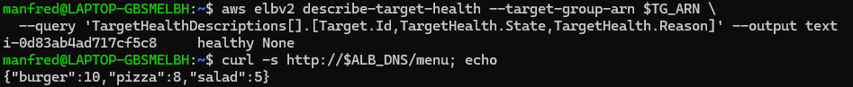
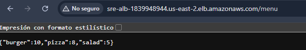
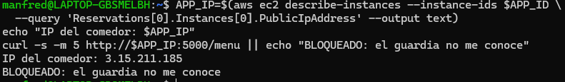
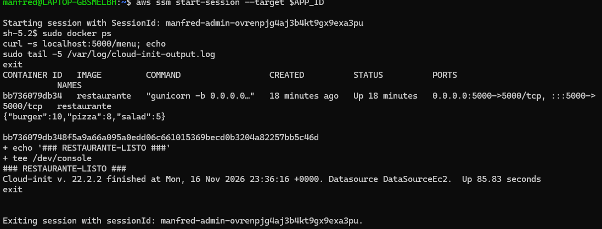
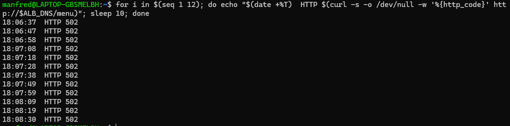
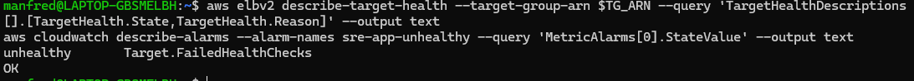
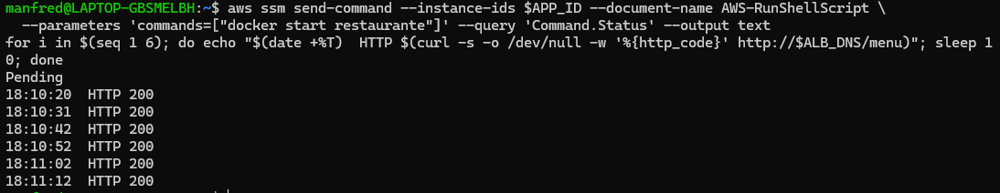

# Week 2 — Compute, load balancing, managed database and alerting (us-east-2)

Goal: run a containerized API behind a load balancer, keep the database private,
get an email when the service breaks — then prove it by breaking it on purpose.
Everything was built from the AWS CLI on top of the Week 1 VPC, then torn down.

## Architecture

~~~
                         Internet
                            |
                         :80 HTTP
                            v
      +-----------------------------------------------+
      |  ALB sre-alb   (pub-a + pub-b, 2 AZs)          |   SG sre-alb : 80 from 0.0.0.0/0
      |  listener :80 -> target group sre-app-tg       |
      |  health check GET /menu every 15 s (2/2)       |
      +-----------------------------------------------+
                            |
                         :5000
                            v
      +-----------------------------------------------+
      |  EC2 sre-app-1  t3.micro, Amazon Linux 2023    |   SG sre-app : 5000 from SG sre-alb only
      |  Docker: restaurant API (Flask + Gunicorn)     |   no port 22 -> access via SSM Session Manager
      |  IMDSv2 required, IAM role = SSM only          |
      +-----------------------------------------------+
                            |
                         :5432
                            v
      +-----------------------------------------------+
      |  RDS PostgreSQL sre-db  db.t3.micro            |   SG sre-db : 5432 from SG sre-app only
      |  priv-a + priv-b, not publicly accessible,     |
      |  storage encrypted                             |
      +-----------------------------------------------+

  CloudWatch alarm  UnHealthyHostCount >= 1 (1 min)  ->  SNS topic sre-alertas  ->  email
~~~

**Chained security groups:** each tier only trusts the security group in front of it,
not an IP range. Nobody on the internet can reach :5000 or :5432, even though the
app instance has a public IP (needed only for egress at boot: packages + git clone).

## What was built

| Step | Resource | Key decisions |
| --- | --- | --- |
| 1 | User-data script | Installs Docker + git, clones [restaurant-simulation-API](https://github.com/ManfredM10/restaurant-simulation-API), `docker build`, `docker run --restart always -p 5000:5000`. `set -euxo pipefail` so failures stop the script and are logged |
| 2 | EC2 `sre-app-1` | AL2023 AMI resolved from the public SSM parameter, IMDSv2 required, instance profile with `AmazonSSMManagedInstanceCore` only |
| 3 | Target group `sre-app-tg` | HTTP :5000, health check `/menu`, interval 15 s, healthy/unhealthy threshold 2 (failure detected in ~30 s) |
| 4 | ALB `sre-alb` | Internet-facing, two public subnets in two AZs, listener :80 forwarding to the target group |
| 5 | RDS `sre-db` | PostgreSQL db.t3.micro, DB subnet group with the two private subnets, `--no-publicly-accessible`, `--storage-encrypted`, single-AZ (lab only) |
| 6 | SNS `sre-alertas` | Email subscription (confirmed) |
| 7 | CloudWatch alarm `sre-app-unhealthy` | `AWS/ApplicationELB UnHealthyHostCount`, Maximum over 60 s, >= 1, alarm and OK actions to SNS |

The DB master password was generated randomly into a `chmod 600` file and never printed.
In production it would live in a secret store (AWS Secrets Manager).

## Evidence

**The app is served through the ALB and the target is healthy**

**Going around the load balancer is blocked** — direct request to the instance on :5000 times out:

**Admin access without SSH** — Session Manager, no port 22, no key pair. Cloud-init finished in ~86 s:

**Database reachability**

| From | Test | Result |
| --- | --- | --- |
| My laptop | `getent hosts <rds-endpoint>` | Resolves to a private IP (10.0.11.x) |
| My laptop | TCP connect to :5432 | Blocked |
| App instance (via SSM) | TCP connect to :5432 | Open |

## Game day: break it on purpose

1. Stopped the container remotely, without logging in:
   `aws ssm send-command --document-name AWS-RunShellScript --parameters 'commands=["docker stop restaurante"]'`
2. Polled the ALB every 10 s and watched target health and the alarm.
3. Restarted the container the same way and watched it recover.

Both emails arrived: `ALARM` when the target went unhealthy and `OK` after recovery.

**Prediction vs reality:** I expected **503**, but got **502**.
With *all* targets unhealthy, the ALB **fails open** and keeps routing to them, so a stopped
container returns 502 Bad Gateway. A 503 means the target group has no registered targets at all.

## Teardown (verified)

Deleted in dependency order: alarm and SNS topic -> ALB -> target group -> instance and RDS
(`--skip-final-snapshot`, lab only) -> DB subnet group. Then verified: no running instances,
no load balancers, no DB instances, no Elastic IPs. The VPC, subnets, IGW, route table,
security groups and IAM role stay (no cost) and will be imported into Terraform in Lab 1.

## Lessons

- **502 vs 503:** all targets unhealthy -> fail open -> 502; no registered targets -> 503.
- **Eventual consistency:** deleting the target group right after the ALB returned `ResourceInUse`.
  Diagnosed (no load balancers left, `LoadBalancerArns` empty) and simply retried. Tools like Terraform retry this automatically.
- **Where to look when user-data fails:** `/var/log/cloud-init-output.log`.
- **Security finding (low):** the API also exposes `/metrics` (Prometheus) through the ALB.
  To fix in Lab 1 with a listener rule that only forwards `/menu` and `/order`.
- **Cost hygiene:** pre-flight check before building (it found an unknown instance, see LEARNING-LOG),
  teardown with verification after.

## Next

Lab 1: the same network and security groups, codified with Terraform (S3 remote state with locking,
`terraform import` of the existing VPC, IMDSv2 and encryption enforced in code).
